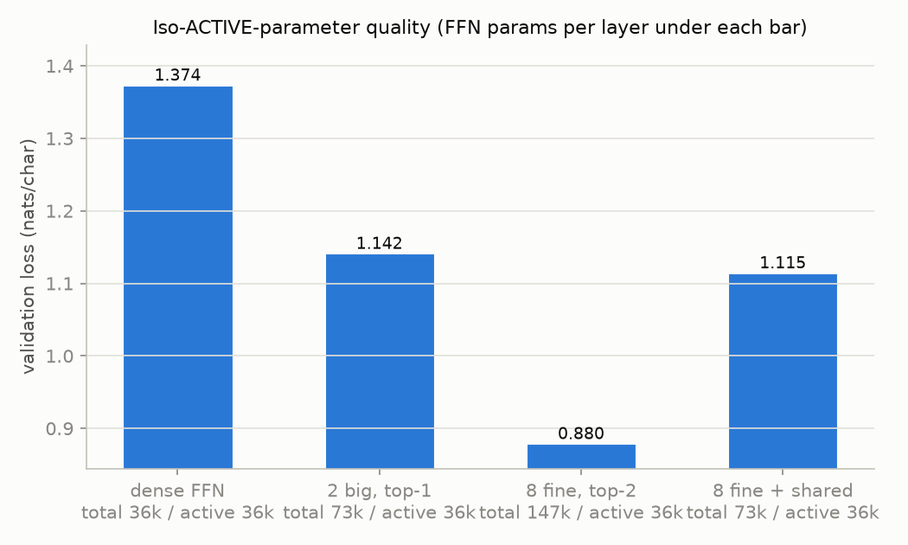
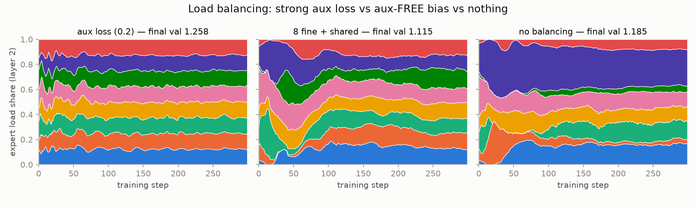
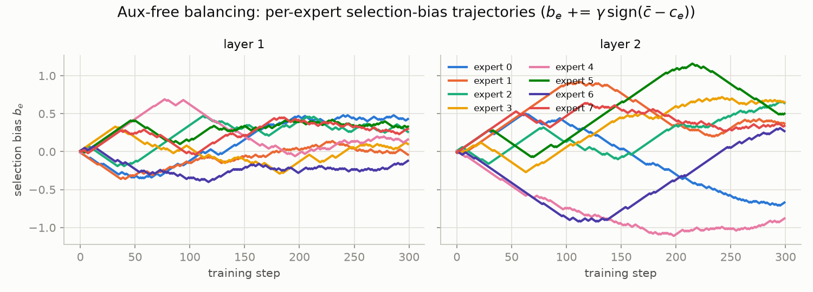
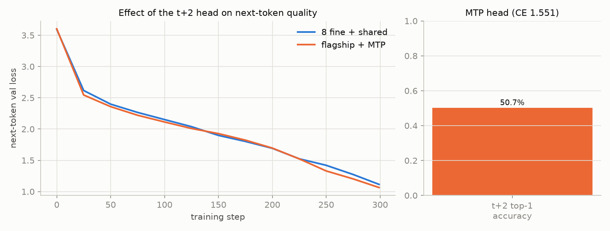
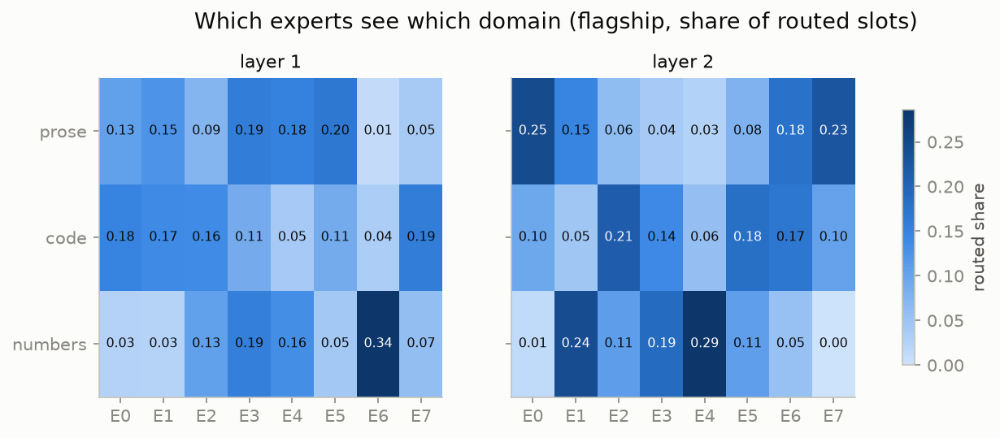
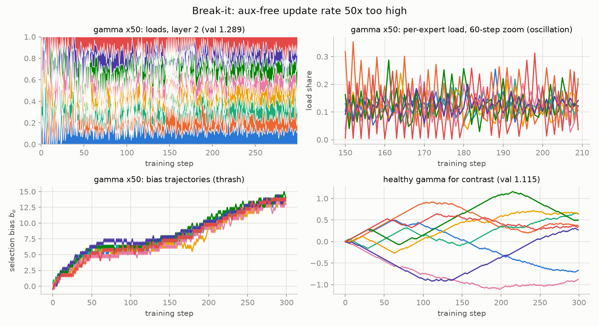
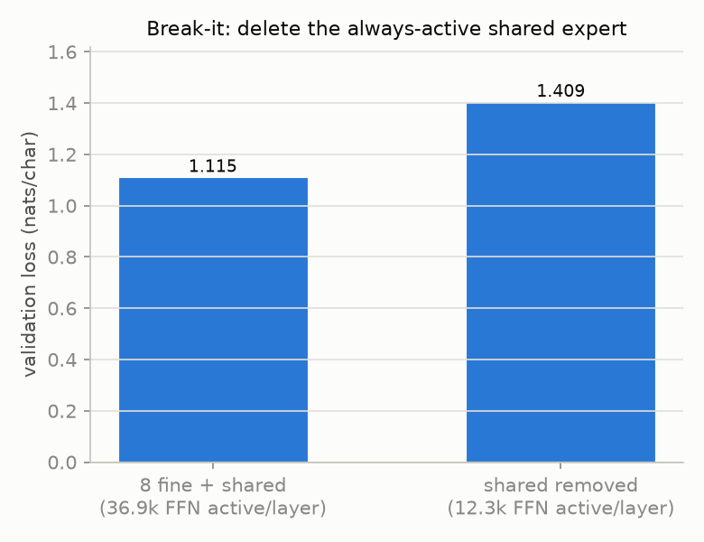
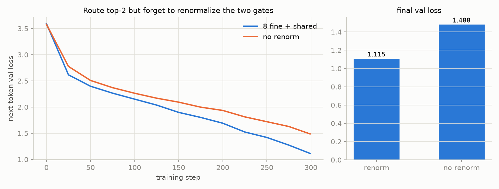

# Modern Sparse-Model Trade-Offs

> Project 18 of 34 — [Step-By-Step LLM Engineering Projects (2026 Edition)](https://x.com/TheAhmadOsman/status/2058745340895870985) by [@TheAhmadOsman](https://x.com/TheAhmadOsman)
>
> **Part X: Mixture Of Experts**

## Goal

Reproduce, at toy scale, the trade-offs behind modern sparse systems: fine-grained and shared experts, auxiliary-loss-free load balancing, and multi-token prediction — the DeepSeek-V3 / Llama 4 / Qwen3 / Kimi K2 design space.

## The project loop

1. **Build it.** Implement the core idea yourself before using the library version.
2. **Plot it.** Loss curves, latency curves, memory curves, attention heatmaps, routing histograms, entropy plots, or failure galleries.
3. **Break it.** Ablate the thing you just built and watch what changes.
4. **Explain it.** A short technical note: what you expected, what happened, what surprised you, what you'd try next.

## Artifacts to ship

- [x] **Implementation** — clean code with tests (`sparse_moe_tradeoffs/`, 15 pytest tests)
- [x] **Notebook** — one reproducible experiment (`experiments/run_all.py`, seeded; writes `results.json`)
- [x] **Plots** — at least three charts showing behavior (8 in `plots/`)
- [x] **Failure gallery** — examples where the system breaks
- [x] **Write-up** — what I learned and what changed my mind

---

*Status: implemented — 2-layer char LM with dense / coarse / fine-grained + shared MoE FFNs, aux-loss and aux-loss-free balancing, and a t+2 MTP head; 10 training runs, 8 plots, 15 green tests.*

## Quickstart

```bash
pip install torch numpy matplotlib pytest
python demo.py          # all 10 runs + 8 plots + results.json (~5.5 min on 2 CPU threads)
pytest                  # 15 tests, ~3 s
python experiments/run_all.py --quick   # 40-step smoke run
```

## What is built

- `sparse_moe_tradeoffs/configs.py` — `MoESpec` plus closed-form parameter algebra. With 8 routed experts at top-2, active/total is always 1/4, so a plain fine-grained MoE can never match a coarse 2-expert top-1 MoE on **both** total and active params. Adding a shared expert of width `s = 4u` (routed width `u`, coarse width `6u`) solves both conditions exactly. That gives the family: dense (hidden 6u), coarse (2×6u, top-1), fine_iso (8×3u, top-2, iso-active but 2× total) and **flagship** (8×u top-2 + shared 4u, iso-total *and* iso-active with coarse).
- `model.py` — token-choice top-k `MoELayer` (fused expert matmul, verified equal to per-expert dispatch), optional always-on shared expert, Switch/GShard aux loss, and **aux-loss-free balancing**: a per-expert bias buffer added to the router logits for **top-k selection only** (gates always come from the unbiased softmax), updated after each step by `b_e += γ·sign(mean_load − load_e)`. `CharLM` adds an optional t+2 multi-token-prediction head, built after the trunk init so the trunk stays bit-identical.
- `corpus.py` — a procedural mixed corpus (prose / code / arithmetic) with a per-character domain tag, used to measure routing specialization.
- `train.py` — training loop that logs per-step expert loads and biases, plus fixed validation batches.

Setup for every run: d=96, 2 layers, 4 heads, block 128, batch 16, **300 steps**, AdamW lr 3e-3, seed 0, 150k-char corpus (vocab 46). Every number below is taken from `results.json`, written by `python demo.py`.

| run | what changed | params | final val loss |
|---|---|---:|---:|
| dense | one FFN, hidden 192 | 169,536 | 1.3742 |
| coarse | 2 experts × 192, top-1 | 243,648 | 1.1422 |
| fine_iso | 8 × 96, top-2 (iso-active, 2× total) | 392,256 | **0.8799** |
| flagship | 8 × 32 top-2 + shared 128, aux-free bias | 244,800 | 1.1154 |
| aux | flagship, aux loss 0.2 instead of bias | 244,800 | 1.2580 |
| none | flagship, no balancing at all | 244,800 | 1.1853 |
| mtp | flagship + t+2 head (coef 0.5) | 249,408 | 1.0653 (t+2 acc 50.7%) |
| gamma50 | flagship, γ = 0.5 (50×) | 244,800 | 1.2886 |
| no_shared | flagship, shared expert deleted | 195,648 | 1.4086 |
| no_renorm | flagship, top-2 gates not renormalized | 244,800 | 1.4877 |

## Results


At matched *active* FFN params per token, every sparse layout beats dense (1.374). Flagship (fine + shared, 1.115) edges coarse (1.142) at identical total **and** active counts. fine_iso wins outright (0.880), but it carries 2× the total parameters. The algebra in `configs.py` shows that this is unavoidable without a shared expert, so its win is a capacity effect, not a free lunch.


Layer-2 expert load share over training. The aux loss (0.2) gives the flattest loads but the worst loss of the three (1.258). With no balancing, one expert (purple) holds about 30–40% of slots for the whole run (1.185). The aux-free bias starts unbalanced and converges to near-uniform loads by about step 120, with the best loss (1.115).


Per-expert selection biases under γ=0.01. Each bias walks linearly (that is the sign rule) until its expert crosses the mean load, then reverses. The trajectories stay within about ±1.2 logits.


The t+2 head did not hurt next-token loss: it finished lower (1.065 vs 1.115) on an identical trunk init. The head reaches 50.7% top-1 accuracy predicting two characters ahead (CE 1.551).


Share of routed slots per domain for the flagship. Layer 1 already isolates arithmetic (E6 takes 34% of number tokens and about 1% of prose). Layer 2 splits prose (E0, E7) from numbers (E1, E4), and code is spread over E2, E5 and E6. This is soft specialization that emerged with no domain signal in the loss.

## Failure gallery


**Bias update rate 50× too high (γ=0.5).** Loads flip from step to step: in the 60-step zoom, single experts swing between about 0% and 30% of slots. The final loss is 1.289, worse than having no balancing (1.185). The biases also drift upward together to about 14. A common shift does not change top-k, but the per-expert differences jitter by ±0.5 every step, so routing is effectively re-randomized each step.


**Delete the shared expert.** Active FFN params per layer drop from 36.9k to 12.3k, and loss rises from 1.115 to 1.409, worse than the dense baseline (1.374). The routed experts in the flagship are deliberately thin (width 32): the shared expert carries the common computation and they only add corrections.


**Forget to renormalize the top-2 gates.** With 8 experts the two selected softmax probabilities sum to well below 1, so the routed output is scaled down. The model can only recover that scale by making the router sharper, which plausibly competes with routing well (not separately measured here). This was the single most damaging bug: 1.488 vs 1.115, and the worst loss of all ten runs.

## Write-up

**Expected:** fine-grained + shared would beat coarse at matched params, aux-free balancing would beat a strong aux loss, and MTP would cost a little next-token quality in exchange for the extra head.

**What happened:** the first two held at this scale. Flagship beat coarse by 0.027 nats and aux-free beat aux(0.2) by 0.143. MTP *helped* next-token loss (−0.050) rather than costing it, which suggests that the denser training signal outweighs the competition for trunk capacity, even at 2 layers. The cleanest result is negative: removing the shared expert or skipping gate renormalization does more damage than any balancing choice.

**What surprised me:** "no balancing" was not a disaster (1.185, better than the strong aux loss). With only 8 experts and 300 steps, one hot expert does not starve the others badly enough to matter, while an aux coefficient of 0.2 visibly competes with the LM loss. The flagship-vs-coarse gap is also small and not robust. In an earlier `--steps 600` run (same code, before steps were cut for the runtime budget), flagship and coarse were 0.604 and 0.620, and "no balancing" came first at 0.591. So the balancing ranking is not stable across training length, at this scale.

**Caveats:** single seed, 300 steps, and validation loss is still falling for every run. The differences that are large relative to run-to-run noise are dense vs sparse, the two break-its, and fine_iso's capacity win. Treat the small gaps (flagship vs coarse, auxfree vs none) as suggestive.

**Next:** run 3–5 seeds with error bars; sweep the aux coefficient (0.001–0.2) against γ; add capacity-factor token dropping to show what aux-free avoids; measure per-token FLOPs and latency for fine vs coarse dispatch; try MTP with a sequential (DeepSeek-V3-style) extra transformer block instead of a parallel linear head.
